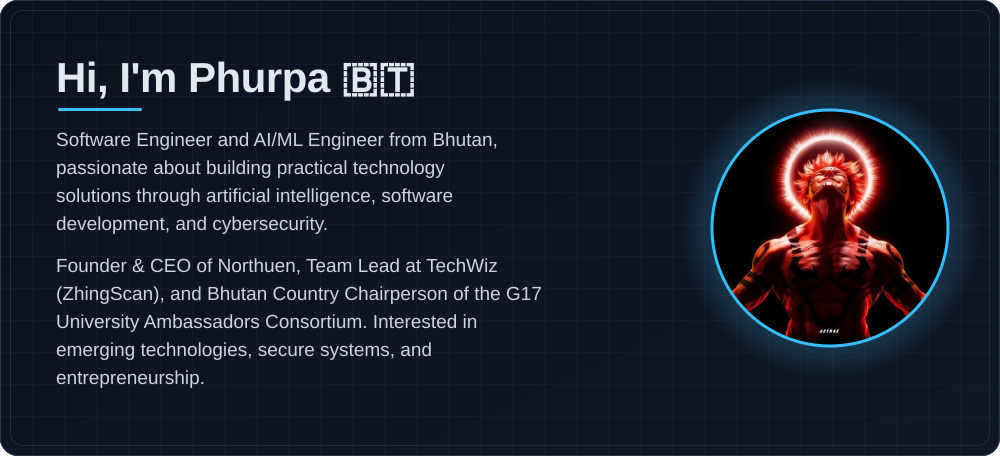
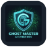
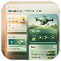
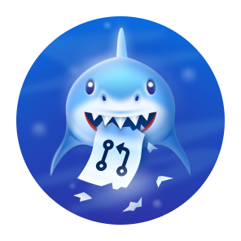

## About Me

  

<b>Software Engineering</b> &nbsp;·&nbsp; <b>AI/ML Engineering</b> &nbsp;·&nbsp; <b>Cybersecurity</b>

## Technical Skills

<table width="100%">
  <tr>
    <td width="170"><b>Programming</b></td>
    <td>
      
    </td>
  </tr>
  <tr>
    <td><b>AI / LLMs</b></td>
    <td>
      
      
      
       
      Claude (Anthropic API, LLM agents) · ChatGPT · Grok · Llama
    </td>
  </tr>
  <tr>
    <td><b>Backend</b></td>
    <td>
      
    </td>
  </tr>
  <tr>
    <td><b>Mobile</b></td>
    <td>
      
    </td>
  </tr>
  <tr>
    <td><b>Database</b></td>
    <td>
      
    </td>
  </tr>
  <tr>
    <td><b>Cloud &amp; DevOps</b></td>
    <td>
       
      AWS Certified
    </td>
  </tr>
  <tr>
    <td><b>Security</b></td>
    <td>OWASP · Secure coding</td>
  </tr>
  <tr>
    <td><b>Tools</b></td>
    <td>
      
      
      
      
       
      Git · GitHub · VS Code · Figma · Android Studio · Xcode · Jira · Asana · Google Colab · CapCut
    </td>
  </tr>
</table>

## Featured Projects

<table width="100%">
  <tr>
    <td width="50%" valign="top">
      <h3>&nbsp; <a href="https://github.com/Dev4Bht/AI_SOC">AI_SOC</a></h3>
      
Bhutan Cyber Intelligence Platform: a multi-tenant cyber threat intelligence and attack-surface monitoring platform. Foundation phase complete, with authentication, role-based access, asset registration, and audit logging.

      
<code>Python</code> · <code>FastAPI</code> · <code>PostgreSQL</code> · <code>Redis</code> · <code>Docker</code>

      
<a href="https://github.com/Dev4Bht/AI_SOC"><b>Repository →</b></a>

    </td>
    <td width="50%" valign="top">
      <h3>&nbsp; <a href="https://github.com/Dev4Bht/My_SOC">My_SOC</a></h3>
      
An autonomous security operations center for small organizations. It correlates alerts into incidents, investigates them with a Claude-powered agent over read-only log tools, and surfaces a short list of decisions for a human.

      
<code>Python</code> · <code>FastAPI</code> · <code>Claude API</code> · <code>Typer</code>

      
<a href="https://github.com/Dev4Bht/My_SOC"><b>Repository →</b></a>

    </td>
  </tr>
  <tr>
    <td width="50%" valign="top">
      <h3>&nbsp; ZhingScan</h3>
      
An AI-powered crop pest and disease identification assistant designed to support farmers with image-based guidance.

      
<code>Flutter</code> · <code>Flask</code> · <code>Python</code>

      
🏆 Winner, RUB Business Incubation Centre Competition Built by TechWiz · <i>Private repository</i>

    </td>
    <td width="50%" valign="top">
      <h3>&nbsp; Northuen</h3>
      
A Bhutan-focused on-demand delivery platform connecting customers, local vendors, and delivery partners for everyday errands and deliveries.

      
Founded and led as Founder &amp; CEO

    </td>
  </tr>
  <tr>
    <td width="50%" valign="top">
      <h3>&nbsp; SFarm</h3>
      
An AI-powered smart farming assistant integrating IoT sensors, weather data, and AI to support data-driven agricultural decisions.

      
🏆 Top 10, AI4Tarayana

    </td>
    <td width="50%" valign="middle" align="center">
      <a href="https://github.com/Dev4Bht?tab=repositories"><b>More repositories →</b></a>
    </td>
  </tr>
</table>

## Honors &amp; Awards

<table width="100%">
  <tr>
    <td width="64" align="center"></td>
    <td><b>Winner</b> — National Agri-Food Innovation Challenge 2024</td>
  </tr>
  <tr>
    <td width="64" align="center"></td>
    <td><b>Winner</b> — RUB Business Incubation Centre Competition · ZhingScan</td>
  </tr>
  <tr>
    <td width="64" align="center"></td>
    <td><b>Best Idea Award</b> — APYDF Bangkok 2024</td>
  </tr>
  <tr>
    <td width="64" align="center"></td>
    <td><b>Top 6</b> — Bhutan Startup Launchpad 2026</td>
  </tr>
  <tr>
    <td width="64" align="center"></td>
    <td><b>Top 10</b> — AI4Tarayana · SFarm</td>
  </tr>
</table>

## Leadership &amp; Experience

<table width="100%">
  <tr>
    <td width="42%"><b>Bhutan Country Chairperson</b></td>
    <td>G17 University Ambassadors Consortium 2026–2027</td>
  </tr>
  <tr>
    <td width="42%"><b>Founder &amp; CEO</b></td>
    <td>Northuen</td>
  </tr>
  <tr>
    <td width="42%"><b>Founder, Team Lead &amp; AI Specialist</b></td>
    <td>TechWiz · ZhingScan</td>
  </tr>
  <tr>
    <td width="42%"><b>Project Leadership</b></td>
    <td>AI/ML and software development projects</td>
  </tr>
</table>

## Memberships

<table width="100%">
  <tr>
    <td width="33%" align="center" valign="top">
       
      <b>World Food Forum</b> 
      Member · WFF
    </td>
    <td width="33%" align="center" valign="top">
       
      <b>Local Conference of Youth</b> 
      Member · LCOY
    </td>
    <td width="33%" align="center" valign="top">
       
      <b>Evaluation Association of Bhutan</b> 
      Member
    </td>
  </tr>
</table>

## GitHub Activity

  

  
  

## GitHub Achievements

<table>
  <tr>
    <td width="25%" align="center" valign="top">
       
      <b>Pull Shark</b> 
      Had pull requests merged
    </td>
    <td width="25%" align="center" valign="top">
       
      <b>Pair Extraordinaire</b> 
      Co-authored a commit on a merged pull request
    </td>
    <td width="25%" align="center" valign="top">
       
      <b>Quickdraw</b> 
      Closed an issue or pull request within 5 minutes
    </td>
    <td width="25%" align="center" valign="top">
       
      <b>YOLO</b> 
      Merged a pull request without a review
    </td>
  </tr>
</table>

## Interests & Focus

<table>
  <tr>
    <td colspan="2" width="33%" align="center" valign="top">
       
      <b>AI/ML Engineering</b> 
      Practical, AI-powered solutions
    </td>
    <td colspan="2" width="33%" align="center" valign="top">
       
      <b>Secure Software Architecture</b> 
      Systems designed to be secure from the start
    </td>
    <td colspan="2" width="33%" align="center" valign="top">
       
      <b>Cybersecurity Automation</b> 
      Automating threat triage and monitoring
    </td>
  </tr>
  <tr>
    <td colspan="3" width="50%" align="center" valign="top">
       
      <b>Full-Stack Application Development</b> 
      From APIs to mobile and web apps
    </td>
    <td colspan="3" width="50%" align="center" valign="top">
       
      <b>Applied AI Research</b> 
      Turning emerging AI techniques into working tools
    </td>
  </tr>
</table>

## Connect With Me

  &nbsp;&nbsp;
  &nbsp;&nbsp;
  

📧 [phurpadorji398@gmail.com](mailto:phurpadorji398@gmail.com) · [phurpa.d@21.tech.bt](mailto:phurpa.d@21.tech.bt)
