  

  

## About Me

I'm a Software Engineer and AI/ML Engineer passionate about building practical technology solutions. My interests include **artificial intelligence**, **machine learning**, **cybersecurity**, and **secure software development**.

I enjoy transforming ideas into functional products, exploring emerging technologies, and developing solutions that address real-world challenges.

## Technical Skills

<table>
  <tr>
    <td width="150"><b>Programming</b></td>
    <td>
      
    </td>
  </tr>
  <tr>
    <td><b>AI/ML</b></td>
    <td>Anthropic API (Claude) for LLM agents</td>
  </tr>
  <tr>
    <td><b>Backend</b></td>
    <td>
      
    </td>
  </tr>
  <tr>
    <td><b>Mobile</b></td>
    <td>
      
    </td>
  </tr>
  <tr>
    <td><b>Database</b></td>
    <td>
      
    </td>
  </tr>
  <tr>
    <td><b>Security</b></td>
    <td>OWASP · Secure coding</td>
  </tr>
  <tr>
    <td><b>Tools</b></td>
    <td>
      
    </td>
  </tr>
</table>

## Featured Projects

<table>
  <tr>
    <td width="50%" valign="top">
      <h3><a href="https://github.com/Dev4Bht/AI_SOC">AI_SOC</a></h3>
      
Bhutan Cyber Intelligence Platform: a multi-tenant cyber threat intelligence and attack-surface monitoring platform. Foundation phase complete, with authentication, role-based access, asset registration, and audit logging.

      
<code>Python</code> · <code>FastAPI</code> · <code>PostgreSQL</code> · <code>Redis</code> · <code>Docker</code>

    </td>
    <td width="50%" valign="top">
      <h3><a href="https://github.com/Dev4Bht/My_SOC">My_SOC</a></h3>
      
An autonomous security operations center for small organizations. It correlates alerts into incidents, investigates them with a Claude-powered agent over read-only log tools, and surfaces a short list of decisions for a human.

      
<code>Python</code> · <code>FastAPI</code> · <code>Claude API</code> · <code>Typer</code>

    </td>
  </tr>
  <tr>
    <td width="50%" valign="top">
      <h3>ZhingScan</h3>
      
An AI-powered crop pest and disease identification assistant designed to support farmers with image-based guidance.

      
<code>Flutter</code> · <code>Flask</code> · <code>Python</code> · <i>private repository</i>

    </td>
    <td width="50%" valign="top">
      <h3>Northuen</h3>
      
A Bhutan-focused on-demand delivery platform connecting customers, local vendors, and delivery partners for everyday errands and deliveries.

    </td>
  </tr>
  <tr>
    <td width="50%" valign="top">
      <h3>SFarm</h3>
      
An AI-powered smart farming assistant integrating IoT sensors, weather data, and AI to support data-driven agricultural decisions.

    </td>
    <td width="50%" valign="middle" align="center">
      <a href="https://github.com/Dev4Bht?tab=repositories">More repositories →</a>
    </td>
  </tr>
</table>

## GitHub Activity

  

  
  

## Interests & Focus

- 🤖 **AI/ML engineering**
- 🔐 **Secure software architecture**
- 🛡️ **Cybersecurity automation**
- 🧩 **Full-stack application development**
- 🔬 **Applied AI research**

## Connect With Me

  &nbsp;&nbsp;
  &nbsp;&nbsp;
  

📧 [phurpadorji398@gmail.com](mailto:phurpadorji398@gmail.com) · [phurpa.d@21.tech.bt](mailto:phurpa.d@21.tech.bt)
