<h1 align="center">Hi, I'm Phurpa Dorji 👋</h1>
<h3 align="center">Software Engineer | AI/ML Engineer</h3>

🇧🇹 Based in Bhutan

  

I build software and AI-powered solutions focused on solving real-world problems. I'm interested in artificial intelligence, secure software development, cybersecurity, and emerging technologies.

---

## 🧑‍💻 About Me

- 🔭 Software engineering and AI/ML
- 🤖 Building practical AI-powered solutions
- 🔐 Interested in cybersecurity and secure software development
- 🌱 Exploring emerging technologies

---

## 🛠️ Technical Skills

**Programming**

   

**AI/ML** — Anthropic API (Claude) for LLM agents · FastAPI · Pydantic

**Backend**

 

**Mobile**

**Database**

 

**Security** — OWASP · Secure coding

---

## 🚀 Featured Projects

| Project | Description |
| --- | --- |
| [**AI_SOC**](https://github.com/Dev4Bht/AI_SOC) | Bhutan Cyber Intelligence Platform: cyber threat intelligence and attack-surface monitoring (Python, FastAPI, PostgreSQL). |
| [**My_SOC**](https://github.com/Dev4Bht/My_SOC) | An autonomous security operations center that correlates alerts into incidents and investigates them with a Claude-powered agent. |
| **ZhingScan** | Mobile app with a Flutter frontend and a Flask backend running a Python model. *(private)* |
| **Northuen** | |
| **SFarm** | |

---

## 📊 GitHub Statistics

  

  
  

  
  

Cards refresh automatically every day via GitHub Actions.

---

## 🤝 Connect With Me

  
  

